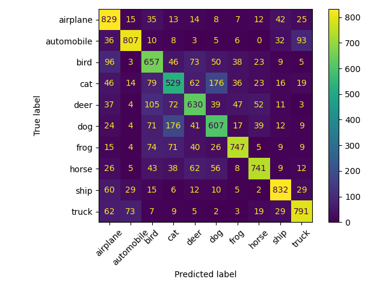

# CIFAR-10 Image Classifier (CNN, PyTorch)

A simple convolutional neural network trained from scratch to classify CIFAR-10 images into 10 classes.



## Problem
CIFAR-10 has 60,000 32x32 colour images across 10 classes (airplane, automobile, bird, cat, deer, dog, frog, horse, ship, truck). Goal: classify each image correctly.

## Approach
- **Model:** `SimpleCNN`: 2 conv layers (32 and 64 filters, 3x3) with ReLU + MaxPool, then 2 fully connected layers (256 -> 10)
- **Loss / Optimizer:** CrossEntropyLoss, Adam (lr=0.001)
- **Training:** 10 epochs, batch size 32
- **Preprocessing:** ToTensor + Normalize (mean=0.5, std=0.5)

## Results
| Metric | Value |
|---|---|
| Test accuracy | 71.7% |

The confusion matrix above shows which classes get confused (e.g. cat vs dog).

## Run it
```
pip install -r requirements.txt
python cifar10.py
```
The script downloads the dataset, trains the model, prints test accuracy, saves `confusion_matrix.png` and `cifar10_model.pth`, and predicts on a sample image.

## Limitations
- Only 2 conv layers, no data augmentation or regularization, so it overfits
- Next step: add augmentation/dropout, or try transfer learning (e.g. ResNet18)

## Author
Prit 
